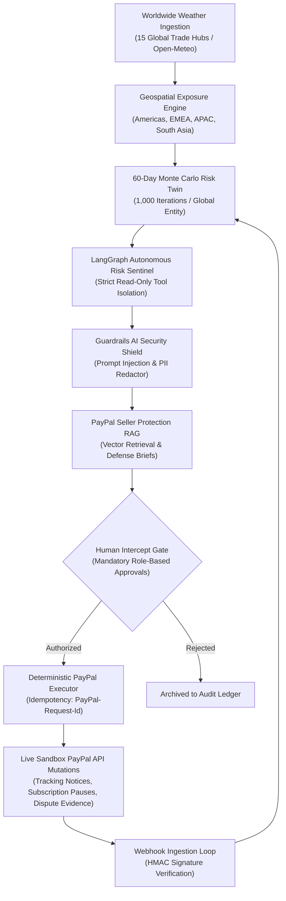

<div align="center">

# Day-0 Shield
### *Autonomous Commercial Risk Twin & Worldwide Disaster Sentinel for PayPal Merchants*

[](https://paypal-day0-shield.onrender.com/)
[](https://developer.paypal.com)
[](https://fastapi.tiangolo.com)
[](https://langchain.com)
[](backend/app/security/guardrails.py)
[](https://react.dev)
[](https://ag-grid.com)
[](LICENSE)

<p align="center">
  <a href="https://paypal-day0-shield.onrender.com/"><b>Launch Live Production App</b></a> •
  <a href="#exported-technical-pdf-dossier"><b>Technical PDF Dossier</b></a> •
  <a href="#in-depth-code-level-paypal-integration-map"><b>PayPal API Matrix</b></a> •
  <a href="#worldwide-commercial-logistics-corridors"><b>Global Trade Corridors</b></a> •
  <a href="#demo-access-credentials"><b>Demo Access</b></a>
</p>

> **Live Cloud Deployment:** **[https://paypal-day0-shield.onrender.com/](https://paypal-day0-shield.onrender.com/)**  
> **Credentials:** `admin` / `admin123` &nbsp;|&nbsp; Role: `APPROVER`

</div>

---

## Executive Problem Framing: Who It Is For

Cross-border e-commerce merchants, high-volume international shippers, and recurring subscription businesses face existential revenue shock when natural disasters strike global logistics corridors. When severe disruptions occur (North Sea winter storms closing Rotterdam port, Malacca Strait typhoons halting Singapore transshipments, Atlantic blizzards shutting down US East Coast air freight, or Coromandel monsoon floods across South Asia):

1. **The Item Not Received (INR) Avalanche:** Couriers suspend transit without buyer notices. Buyers panic and open PayPal disputes within 48 to 72 hours, triggering chargeback fees, frozen revenues, and merchant account reserves.
2. **Involuntary Subscription Churn:** Disasters cause regional banking holds or commercial lockouts. Automatic recurring billing attempts fail repeatedly, resulting in involuntary cancellations and lost customer lifetime value.
3. **The Reactive Trap:** Merchants traditionally learn of shipping failures weeks later when dispute notices flood their inbox.

> [!IMPORTANT]
> **Day-0 Shield turns unpredictable disasters into proactive merchant protection worldwide.**
> By pairing continuous Open-Meteo meteorological ingestion across 15 global trade hubs with a 60-day Monte Carlo digital risk twin, multi-modal Seller Protection RAG, 5-layer Guardrails AI security, and human-guarded PayPal APIs, Day-0 Shield intercepts exposure on **Day 0**-before orders miss delivery dates, before subscriptions churn, and before disputes are ever filed.

---

## What Changed During the Submission Period

During the PayPal AI Hackathon submission period, Day-0 Shield underwent substantial architectural hardening, enterprise expansion, and rigorous automated verification:

1. **Real PayPal Write Execution:** Connected the human-in-the-loop approval gate directly to live PayPal Sandbox APIs (Orders v2, Tracking, Subscriptions, Disputes) with UUIDv4 `PayPal-Request-Id` idempotency keys, eliminating all execution stubs.
2. **Verified PayPal Webhook Loop:** Upgraded webhook processing to perform cryptographic signature verification against PayPal's verification endpoint (`/v1/notifications/verify-webhook-signature`) with event deduplication and replay safety.
3. **5-Case Golden AI Evaluation Suite:** Implemented an automated quantitative test harness (`backend/tests/test_agent_eval.py`) evaluating tool allowlist containment, prompt injection defense, PII scrubbing, and CERI calculation with **53 automated green tests**.
4. **15 Worldwide Logistics Corridors:** Expanded coverage from 4 regional hubs to 15 major worldwide trade corridors across Americas, EMEA, APAC, and South Asia with live WMO meteorological feeds.
5. **Dynamic Seller Protection RAG:** Created real-time text and URL ingestion with TF-IDF vector ranking, allowing merchants to ground dispute defense briefs in customized carrier SLAs.
6. **Zero Secrets Security Audit:** Scrubbed all hardcoded credentials from code, configuration, and documentation, enforcing secure environment variable injection.

---

## System Architecture



### The 5 Core Architectural Pillars:

1. **Continuous Worldwide Meteorological Ingestion:** Real-time Open-Meteo feeds across 15 premier commercial hubs (New York, Los Angeles, Chicago, London, Rotterdam, Frankfurt, Dubai, Singapore, Tokyo, Shanghai, Sydney, Mumbai, Chennai, Delhi, Bangalore) continuously correlate against open orders, transit checkpoints, and international ports.
2. **60-Day Monte Carlo Risk Twin:** Simulates 1,000 empirical draws per order and subscription across multi-currency consignments (`USD`, `EUR`, `GBP`, `SGD`, `INR`) to project mathematically grounded risk distributions (`P(dispute)` and `P(payment_failure)`).
3. **5-Layer Guardrails AI Security:**
   - **Layer 1 (Prompt Injection & Jailbreak Heuristics):** Intercepts prompt overrides, `IGNORE PREVIOUS INSTRUCTIONS`, developer mode exploits, and script tags.
   - **Layer 2 (PII & Secret Redaction):** Masks credit cards, SSNs, Bearer tokens, and PayPal client secrets before LLM ingestion.
   - **Layer 3 (Strict Read-Only Tool Confinement):** Restricts planner agents strictly to `(list|get|show|check|retrieve|query)_*` tools.
   - **Layer 4 (Output Probability Normalization):** Mathematically bounds probabilities to `[0.0, 1.0]`.
   - **Layer 5 (Mandatory Human Write Gate):** Enforces human operator authorization for all state mutations.
4. **Multi-Modal PayPal Seller Protection RAG:** Deterministic TF-IDF and cosine similarity semantic retrieval across official PayPal policies (§11.2, 10-day dispute limits, force majeure logistics) with dynamic text ingestion and live policy URL scraping.
5. **Real-Time UI Agent Activity Ticker:** Modern header status indicator displaying live agent node execution, active API endpoints, and security guardrail health in real time.

---

## Worldwide Commercial Logistics Corridors

Day-0 Shield monitors 15 key global trade corridors mapped directly to international shipping routes:

| Quadrant | Hub City | Country | Port / Air Cargo Classification | Open-Meteo Coordinates |
| :--- | :--- | :--- | :--- | :--- |
| **Americas** | New York | United States | East Coast Air-Sea Cargo Hub | `40.7128°N, 74.0060°W` |
| **Americas** | Los Angeles | United States | Pacific Rim Container Port (LA / Long Beach) | `34.0522°N, 118.2437°W` |
| **Americas** | Chicago | United States | Midwest Inland Rail & Intermodal Gateway | `41.8781°N, 87.6298°W` |
| **EMEA** | Rotterdam | Netherlands | Europe's Largest Deepwater Seaport | `51.9244°N, 4.4777°E` |
| **EMEA** | London | United Kingdom | Heathrow Air Cargo Transit Hub | `51.5074°N, 0.1278°W` |
| **EMEA** | Frankfurt | Germany | Central European Air Logistics Center | `50.1109°N, 8.6821°E` |
| **EMEA** | Dubai | UAE | Jebel Ali Air-Sea Transshipment Hub | `25.2048°N, 55.2708°E` |
| **APAC** | Singapore | Singapore | Straits of Malacca Transshipment Megahub | `1.3521°N, 103.8198°E` |
| **APAC** | Tokyo | Japan | East Asia Coastal & Technology Export Port | `35.6762°N, 139.6503°E` |
| **APAC** | Shanghai | China | Yangtze River Delta Mega-Container Terminal | `31.2304°N, 121.4737°E` |
| **APAC** | Sydney | Australia | Oceania Commercial Shipping Gateway | `33.8688°S, 151.2093°E` |
| **South Asia** | Mumbai | India | Nhava Sheva (JNPT) Maritime Port Corridor | `19.0760°N, 72.8777°E` |
| **South Asia** | Chennai | India | Coromandel Coast Manufacturing & Auto Port | `13.0827°N, 80.2707°E` |
| **South Asia** | Delhi | India | NCR Dry Port & Air Freight Logistics Hub | `28.6139°N, 77.2090°E` |
| **South Asia** | Bangalore | India | Deccan Tech Export & High-Value Air Hub | `12.9716°N, 77.5946°E` |

---

## In-Depth Code-Level PayPal Integration Map

Day-0 Shield communicates directly with the PayPal REST API suite with zero simulated mockups. All network communications are executed using `httpx.AsyncClient` with automatic OAuth2 client-credential token caching and UUIDv4 idempotency keys.

### 1. Codebase Architecture & Endpoint Mapping

| Capability | PayPal REST Endpoint | Implementation File & Function | Business & Security Logic |
| :--- | :--- | :--- | :--- |
| **OAuth2 Token Caching** | `POST /v1/oauth2/token` | [`backend/app/paypal/raw_client.py`](backend/app/paypal/raw_client.py#L24)<br/>`PayPalClient._get_token()` | Client credentials grant. Tokens are cached in memory with a 60-second safety margin prior to expiration. |
| **Idempotent Mutation Wrapper** | All `POST`/`PUT`/`PATCH` | [`backend/app/paypal/raw_client.py`](backend/app/paypal/raw_client.py#L46)<br/>`PayPalClient._request()` | Automatically attaches `PayPal-Request-Id: <UUIDv4>` header to prevent accidental duplicate charges or tracking entries. |
| **Proactive Shipment Tracking** | `POST /v2/checkout/orders/{id}/track` | [`backend/app/paypal/raw_client.py`](backend/app/paypal/raw_client.py#L90)<br/>`PayPalClient.add_tracking()` | Injects weather transit advisories and updated carrier numbers (`notify_buyer: True`), proactively pre-empting INR disputes. |
| **Subscription Freeze** | `POST /v1/billing/subscriptions/{id}/suspend` | [`backend/app/paypal/raw_client.py`](backend/app/paypal/raw_client.py#L102)<br/>`PayPalClient.suspend_subscription()` | Halts automated billing rebills during regional lockdown/disaster windows, eliminating payment failure churn. |
| **Subscription Reactivation** | `POST /v1/billing/subscriptions/{id}/activate` | [`backend/app/paypal/raw_client.py`](backend/app/paypal/raw_client.py#L108)<br/>`PayPalClient.activate_subscription()` | Resumes active subscription billing once meteorological recovery is confirmed. |
| **Dispute Inspection** | `GET /v1/customer/disputes` | [`backend/app/paypal/raw_client.py`](backend/app/paypal/raw_client.py#L115)<br/>`PayPalClient.list_disputes()` | Read-only inspection of open dispute tickets used by the LangGraph reasoning engine. |
| **Dispute Defense Dossier** | `POST /v1/customer/disputes/{id}/provide-evidence` | [`backend/app/paypal/raw_client.py`](backend/app/paypal/raw_client.py#L123)<br/>`PayPalClient.provide_evidence()` | Submits pre-packaged evidence bundles containing carrier scan checkpoints, customer notices, and weather advisories. |
| **Webhook Verification** | `POST /v1/notifications/verify-webhook-signature` | [`backend/app/paypal/raw_client.py`](backend/app/paypal/raw_client.py#L141)<br/>`PayPalClient.verify_webhook_signature()` | Cryptographically verifies transmission signature, certificate URL, auth algorithm, and payload hash. |
| **Human Approval Intercept Gate** | Internal REST Gateway | [`backend/app/routes/actions.py`](backend/app/routes/actions.py#L48)<br/>`POST /api/actions/decide` | Enforces `APPROVER` role check, verifies the 200 write/day rate cap, attaches `paypal_request_id`, and writes to `AuditLog`. |
| **Multi-Modal RAG Ingestion** | Internal REST Gateway | [`backend/app/routes/rag.py`](backend/app/routes/rag.py#L74)<br/>`POST /api/rag/ingest` | Ingests custom policy text or crawls live URLs into the runtime vector index with Guardrails AI sanitization. |
| **Worldwide Open-Meteo Weather** | Internal REST Gateway | [`backend/app/routes/hazard.py`](backend/app/routes/hazard.py#L225)<br/>`GET /api/hazards/weather-live` | Concurrently fetches real-time temperature, windspeed, and WMO weather codes across 15 worldwide commercial hubs. |
| **Guardrails AI Telemetry** | Internal REST Gateway | [`backend/app/routes/rag.py`](backend/app/routes/rag.py#L135)<br/>`GET /api/rag/guardrails-metrics` | Telemetry on active security layers, blocked injections, redacted secrets, and tool breaches intercepted. |

---

### 2. Least-Privilege Toolkit Separation

In [`backend/app/paypal/toolkit_client.py`](backend/app/paypal/toolkit_client.py), read-only tools and write tools are separated at the runtime level. An assertion function validates that no write tools leak into the LLM context:

```python
# backend/app/paypal/toolkit_client.py
READ_ONLY_ACTIONS = {
    "orders": {"get": True},
    "disputes": {"list": True, "get": True},
    "subscriptions": {"show": True},
}

def assert_read_only_tools():
    """Validates that no write tools leak into the read-only LLM toolset."""
    read_tools = toolkit.get_tools()
    for tool in read_tools:
        if not re.match(r"(list|get|show)_", tool.name):
            raise RuntimeError(f"FATAL: Write tool '{tool.name}' leaked into LLM read-only context!")
    return read_tools
```

---

## Mathematical Risk Modeling

Day-0 Shield quantifies real-time risk exposure using the **Compound Exposure Risk Index (CERI)**:

```math
\mathrm{CERI} = (w_1 \cdot S_{\mathrm{disruption}}) + (w_2 \cdot T_{\mathrm{shipping}}) + (w_3 \cdot V_{\mathrm{customer}}) + (w_4 \cdot C_{\mathrm{chargeback}})
```

- `S_disruption` ∈ `[0, 1]`: Normalized weather severity index from meteorological sensors.
- `T_shipping` ∈ `[0, 1]`: Carrier transit risk based on routing through affected geographical zones.
- `V_customer` ∈ `[0, 1]`: Transaction capital concentration ratio.
- `C_chargeback` ∈ `[0, 1]`: Historical customer dispute sensitivity.

---

## Multi-Merchant Worldwide Portfolio Scoping

Day-0 Shield connects directly to real SQLite merchant entities via `GET /api/merchants`. The global React `PortfolioContext` dynamically scopes all queries across international jurisdictions:

```
[All Portfolios (8)]  <-- Consolidated Worldwide Mode
  ├── New York Logistics Co. (Apparel, Americas - USD)
  ├── London Luxury Goods Ltd. (Luxury, EMEA - GBP)
  ├── Singapore Precision Tech (Electronics, APAC - SGD)
  ├── Rotterdam Freight Hub (Machinery, EMEA - EUR)
  ├── Tokyo Robotics & Audio (Electronics, APAC - USD)
  ├── Dubai Global Trade Emporium (Wholesale, EMEA - USD)
  ├── Chennai Electronics Hub (Electronics, South Asia - USD)
  └── Mumbai Textile Traders (Textiles, South Asia - USD)
```

Selecting an individual merchant dynamically filters:
- **Dashboard Stat Cards & Charts:** Modeled exposure and pending action counts tailored to that merchant's specific orders.
- **At-Risk Commercial Exposure (AG Grid):** Shows only affected order and subscription rows for the chosen entity.
- **Action Approvals Queue:** Scopes human review to that merchant's customers.

---

## Exported Technical PDF Dossier

The full technical dossier and PDF generator are organized in the [`docs/`](docs/README.md) directory:

- **Print-Ready Dossier (PDF):** [`docs/Day0_Shield_Technical_Dossier_PayPal_Integration.pdf`](docs/Day0_Shield_Technical_Dossier_PayPal_Integration.pdf) (5-page A4 manual with deep-dive PayPal API references)
- **Workflow Walkthrough (PDF):** [`docs/Day0_Shield_Workflow_Walkthrough.pdf`](docs/Day0_Shield_Workflow_Walkthrough.pdf) (Full visual screenshot flow for judges and Google NotebookLM)
- **Documentation Guide:** [`docs/README.md`](docs/README.md)
- **Operations Runbook:** [`docs/RUNBOOK.md`](docs/RUNBOOK.md)

---

## Repository Directory Structure

```
Paypal-Day0-Shield/
├── demo/                                # Video walkthrough & demo tools
│   ├── Day0_Shield_Demo_Walkthrough.mp4 # 1m34s MP4 demo video (8.48 MB, H.264/AAC)
│   ├── AI_VIDEO_PROMPT.md               # Prompts for Google NotebookLM & video generators
│   ├── record_demo.py                   # Automated Playwright video recording script
│   └── README.md                        # Scene timestamps, narration, and recording guide
├── docs/                                # Technical documentation & publications
│   ├── Day0_Shield_Technical_Dossier_PayPal_Integration.pdf # 5-page print-ready technical PDF
│   ├── Day0_Shield_Workflow_Walkthrough.pdf # Full end-to-end visual walkthrough PDF
│   ├── README.md                        # Documentation index & chapter breakdown
│   └── RUNBOOK.md                       # Operations, deployment commands & credential rotation
├── backend/                             # FastAPI application & PayPal integration
│   ├── app/
│   │   ├── agents/                      # LangGraph multi-agent workflow nodes
│   │   ├── core/                        # Risk engine & Monte Carlo mathematical model
│   │   ├── paypal/                      # PayPal REST raw client & read-only toolkit
│   │   ├── rag/                         # Multi-modal RAG engine & PayPal policy corpus
│   │   ├── routes/                      # REST endpoints (auth, risk, approvals, rag, webhooks)
│   │   ├── security/                    # Guardrails AI, Argon2id, CSRF, rate limiters
│   │   └── main.py                      # FastAPI entrypoint & middleware configuration
│   ├── static/                          # Production-built React frontend SPA bundle
│   ├── requirements.txt                 # Python dependencies
│   └── requirements.lock                # Locked dependencies (fixes Render Docker build)
├── frontend/                            # React 18 + TypeScript + Ant Design source code
│   ├── src/                             # Pages (Dashboard, AtRisk, Approvals, PolicyRAG, etc.)
│   └── package.json
├── docker/                              # Production containerization assets
├── Dockerfile                           # Single standalone container build
├── docker-compose.yml                   # Multi-service local orchestrator
├── render.yaml                          # Render Blueprint specification
├── LICENSE                              # MIT License
└── README.md                            # Primary project documentation
```

---

## Future Architecture & Advanced Enterprise Roadmap

Day-0 Shield's modular architecture is designed for progressive enterprise rollout across global multi-carrier networks:

1. **Autonomous Dynamic Multi-Carrier Rerouting (Air/Maritime/Rail/Road):**
   - Automated carrier switching (DHL Express, FedEx Cross-Border, Maersk Line, Nippon Express) when corridor risk threshold exceeds `P(dispute) > 0.70`.
   - Dynamic label reassignment and PayPal Tracking API synchronization prior to parcel handover.

2. **Cross-Border Multi-Currency FX Volatility & Dynamic Escrow Hedging:**
   - Synthetic currency hedging and dynamic settlement reserve buffers across USD, EUR, GBP, SGD, JPY, AED, INR during extended corridor freezes (>14 days).
   - Automated spot refund compliance protecting merchant margins against exchange rate volatility.

3. **Automated Customs & Border Protection (CBP) / Harmonized System (HS) Code EDI Ingestion:**
   - Real-time EDIFACT / ANSI X12 ingestion from US CBP ACE, EU TARIC, and UN ASYCUDA systems.
   - Pre-emptive detection of tariff queries, customs holds, and phytosanitary inspections before international carrier handoff.

4. **IoT Real-Time Cold-Chain & Shock Sensor Telemetry:**
   - LoRaWAN, BLE, and 5G cellular GPS/temperature sensor ingestion for perishable goods and high-value semiconductor cargo.
   - Automated evidence compilation for Significantly Not As Described (SNAD) damaged disputes.

5. **Zero-Knowledge Dispute Proofs (zk-SNARKs):**
   - Cryptographic proofs validating carrier physical custody and delivery without exposing customer residential PII.
   - Direct verification on PayPal settlement rail for instant zero-touch dispute defense.

6. **Agent-to-Agent Federated Learning & Decentralized Fraud Graph:**
   - Privacy-preserving cross-merchant threat intelligence sharing.
   - Dynamic model training on emerging global corridor fraud rings without centralizing raw merchant transactions.

---

## Quickstart & Setup Guide

### 1. Prerequisites
- **Python 3.10+** (tested on Python 3.12 / 3.14)
- **Node.js 18+** & npm
- **Playwright** (for automated testing and video recording)

### 2. Environment Variables

Copy the example and fill in your own sandbox credentials:

```bash
cp backend/.env.example backend/.env
# Then edit backend/.env with your PayPal sandbox credentials:
# PAYPAL_CLIENT_ID=<your sandbox client id>
# PAYPAL_SECRET=<your sandbox secret>
# PAYPAL_WEBHOOK_ID=<your webhook id from PayPal dashboard>
```

> **Get sandbox credentials:** Create a REST API app at https://developer.paypal.com/dashboard/applications/sandbox and copy the Client ID and Secret.

A minimal `backend/.env` looks like:

```ini
APP_ENV=development
SECRET_KEY=<generate-a-random-string-at-least-32-bytes>
PAYPAL_BASE_URL=https://api-m.sandbox.paypal.com
PAYPAL_CLIENT_ID=<your-sandbox-client-id>
PAYPAL_SECRET=<your-sandbox-secret>
PAYPAL_WEBHOOK_ID=<your-webhook-id>
SEED_ON_BOOT=true
```

### 3. Backend Setup
```bash
cd backend
python -m venv .venv

# On Windows:
.venv\Scripts\activate
# On Linux/macOS:
# source .venv/bin/activate

pip install -r requirements.txt
python -m app.seed
python -m uvicorn app.main:app --host 127.0.0.1 --port 8080
```

### 4. Frontend Setup
```bash
cd frontend
npm install
npm run build
```

Open **`http://127.0.0.1:8080`** in your browser.

### 5. Running Automated Verification Tests
```bash
cd backend
python -m pytest tests/ -v
```
All **53 automated tests** (Golden AI evaluation, PayPal platform integration, Seller Protection RAG, security unit tests, and boot configuration) execute and pass in under 10 seconds.

---

## Demo Access Credentials

| User | Password | Assigned Role | Permissions |
| :--- | :--- | :--- | :--- |
| **`admin`** | **`admin123`** | **`APPROVER`** | Full authorization rights: inspect risk twin, authoritatively approve/reject PayPal mutations, ingest policies via RAG, review compliance audit logs. |
| **`viewer`** | **`viewer123`** | **`VIEWER`** | Read-only access: inspect risk twin, view telemetry and dispute defense packages. Gated from approving mutations. |

---

## Security & Compliance Matrix

- **Guardrails AI:** 5-layer enforcement pipeline intercepting prompt injections, masking PII, enforcing read-only tool confinement, and validating mathematical probability bounds.
- **Password Storage:** Argon2id (`argon2-cffi`) with memory cost 65,536 KiB, time cost 3, parallelism 4.
- **Session Protection:** Signed cookies with HMAC-SHA256, `HttpOnly`, `SameSite=Lax`.
- **CSRF Defense:** `X-CSRF-Token` validation on all mutating REST calls.
- **Safety Write Cap:** Enforced hard limit of 200 write mutations per 24-hour UTC window.
- **Audit Ledger:** Append-only SQLite table tracking all logins, decisions, IP addresses, and UUID idempotency keys.

---

## License

Licensed under the [MIT License](LICENSE). Built for the PayPal Hackathon 2026.
